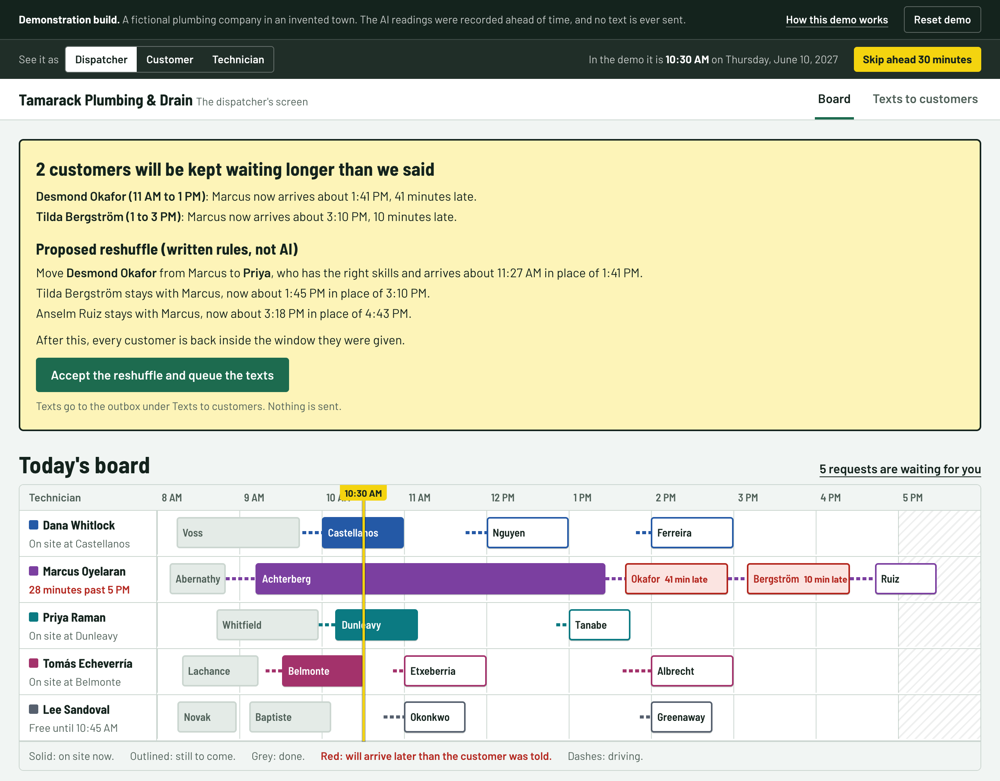
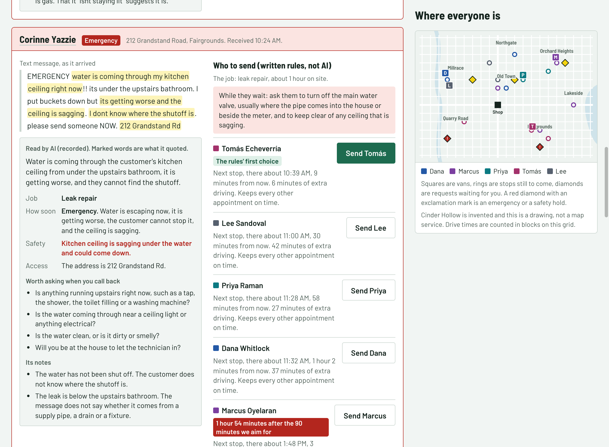
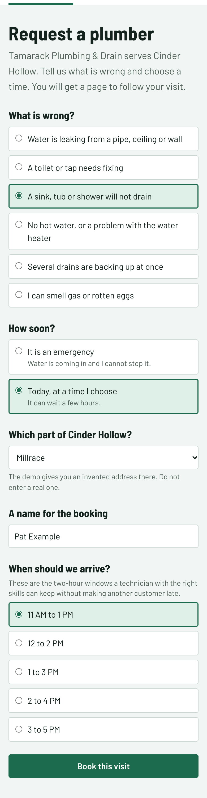
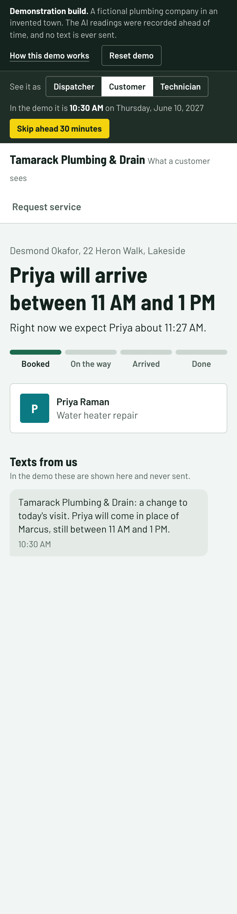
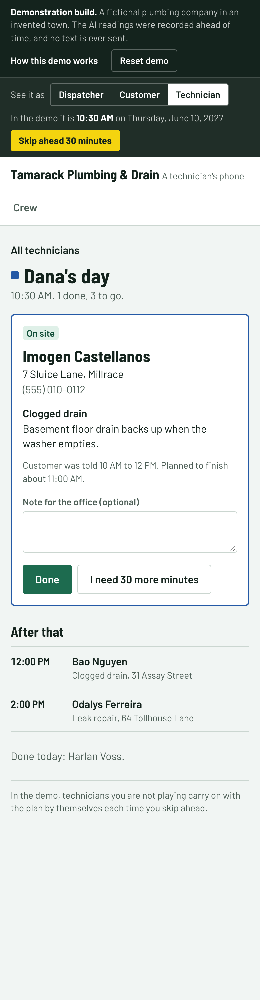
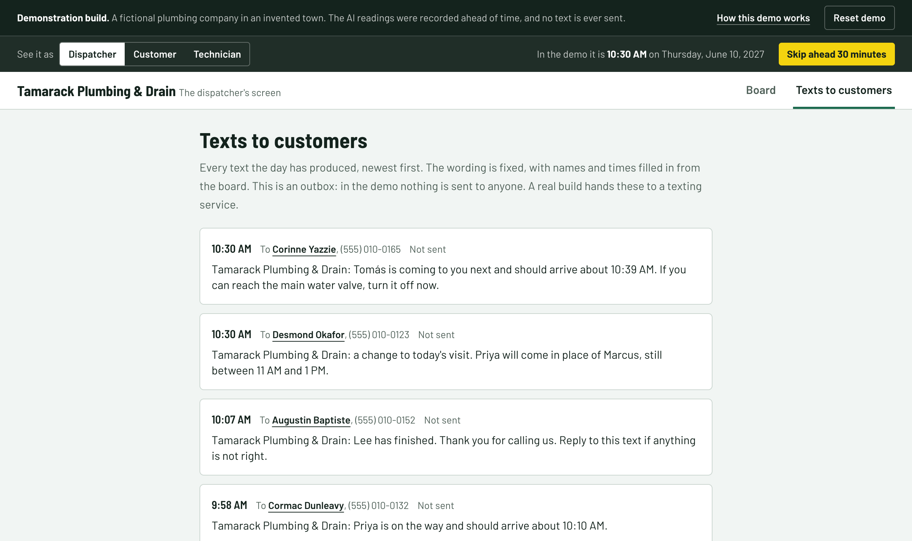

# Service request and dispatch

A service company's day on one board. Customer messages are read by AI into the kind of job and how urgent it is, written rules suggest who to send and say why, and when a job runs long the board shows who will be kept waiting and proposes a fix. The customer, the dispatcher and the technician each get their own screen onto the same day.

> **Demo project.** This is a demonstration build by ChopMedia, not client work. Tamarack Plumbing & Drain is a fictional company and Cinder Hollow is an invented town. Every customer, technician, address, phone number and message is made up. The AI readings were recorded ahead of time and are replayed; the demo does not call an AI model while you use it. No text message is ever sent, and no van is tracked.



**Live demo:** https://service-request-dispatch.vercel.app

## The problem

A plumbing, heating or electrical company with a handful of vans runs on one person's judgment. Requests come in as voicemails, texts and web forms, each written the way a worried homeowner writes. The dispatcher has to work out what the job is, who is able to do it, who is close, and whose afternoon it will wreck.

Then the day stops following the plan. A one-hour repair turns into three. A ceiling starts leaking across town. Every appointment behind the slow job is now late, and the customers find out when nobody turns up. The dispatcher is on the phone to the crew, redrawing the day on a whiteboard, with no time left to call the people who are waiting.

## What it does

- **Reads each incoming message into what a dispatcher needs.** A short summary, the kind of job, how urgent it sounds, anything about getting in, and questions worth asking. The words it relied on are marked in the message.
- **Suggests who to send using written rules, not more AI.** Skills, where each van will be, how much driving it adds, and whether anyone else's appointment would slip. Every technician is listed with the reasons, best first, and the dispatcher chooses.
- **Keeps the whole day honest.** Only the order of jobs and what has happened so far are stored. Every time on the board is worked out from that, so one job running long moves everything behind it.
- **Shows who will be kept waiting, and proposes a repair.** The board names the customers who will be late and which jobs it would move to whom. Accepting it updates the board and writes the texts.
- **Gives the customer and the technician their own screens.** A customer books a window that can be kept and follows the visit. A technician sees their day on a phone and taps on my way, arrived and done.
- **Holds a smell of gas.** A message that mentions one cannot be booked. The customer is told to leave the house and call the gas company or 911.

## Try it

Three things worth clicking first:

1. On the board, read **Renee Kowalczyk's message** under Waiting for you. See what the AI pulled out of it, then who the rules would send and why. Send someone and watch the job land on the board.
2. Press **Skip ahead 30 minutes** twice. At 10:30 a water heater job runs long and a ceiling leak comes in. Accept the reshuffle, send someone to the emergency, then open **Texts to customers**.
3. Switch to **Customer** in the bar at the top and book a visit. You are only offered windows that can be kept. Then switch to **Technician** and work through someone's day.

**Reset demo** in the top bar puts the day back to 9:30 AM.



| Booking as a customer | Following the visit | A technician's phone |
| --- | --- | --- |
|  |  |  |



## What is recorded and what is real

**Recorded: the AI reading.** Each sample message was given to Claude, an AI model made by Anthropic, with the instructions in [`content/READING-INSTRUCTIONS.md`](content/READING-INSTRUCTIONS.md). What it wrote was saved and is replayed. The readings were not edited by hand. Replaying is what lets the demo run for free with no API key. Nothing a visitor types is read by AI, which is why the customer form is made of choices.

**Scripted: the day.** The demo has its own clock, starting at 9:30 AM on Thursday, June 10, 2027. Which messages arrive when, and which job runs long, is fixed in advance. Technicians you are not playing carry on with the plan each time you skip ahead.

**Drawn: the map.** The town is a drawing on a grid of blocks. Drive times are counted in blocks on that drawing. There is no map service, no traffic and no GPS.

**Real: everything else.** Working out the day from the order of jobs, the suggestions and their reasons, the windows a customer is offered, the reshuffle, the gas hold, the technician's buttons and the texts in the outbox all run live on your own private copy of the sample day.

## How it would plug into a real business

- **Real messages in.** Texts and voicemail transcripts from a service such as Twilio, web forms from the company's site, and email. Each arrives the way the samples do and gets a live AI reading with the same instructions, tested first on a few hundred of the company's own past messages.
- **Real texts out.** The outbox hands each text to the same texting service, with replies coming back onto the job.
- **Real drive times and positions.** A mapping service replaces the drawing, and the technician's phone reports where the van is.
- **The company's own rules.** The weights behind a suggestion are a short list in one file. A real build tunes them and adds what matters to the firm: lunch breaks, parts on the van, preferred technicians for repeat customers, overtime limits.
- **The systems already in use.** Jobs and customers sync with the accounting or field-service software the company has, such as QuickBooks, so finished work becomes an invoice there.
- **Sign-in and roles.** The demo has no accounts because every visitor gets a private copy. A real build has sign-in for the office and the crew, and customers follow a visit from a private link.

## What this demo is not

- It is not a route optimiser. The reshuffle makes one helpful move at a time and stops. It does not claim to find the best possible day, and lunch breaks, parts runs and traffic are not modelled.
- It does not send texts, track vans, take payments, write invoices or keep stock of parts.
- It is not a measure of accuracy. A handful of invented messages says nothing about how a model reads a real company's customers. The way to find out is to run it on messages the company has already handled, and that is the first step of a real project.
- It is not safety advice beyond the one rule about gas, and it is not a substitute for calling 911.
- There are no usage numbers, clients or testimonials, because it is a demonstration.

## Tech stack and architecture

Next.js 16 (App Router, React 19, TypeScript), Tailwind CSS 4, Drizzle ORM on Postgres, Zod, Vitest.

```
content/                    the instructions the AI was given
src/
  app/                      pages: the board, a job, texts to customers,
                            the customer's form and visit page,
                            the technician's phone, how the demo works
  components/
    board.tsx               technicians down the side, hours across
    inbox.tsx               a waiting request: message, reading, who to send
    proposal.tsx            who will be late and the proposed reshuffle
    town-map.tsx            the drawing of the town
    request-form.tsx        the customer's form and the windows it offers
  data/
    messages.json           the sample customer messages
    readings/               what the AI read from each one, saved
  lib/
    plan.ts                 works out every time on the board from the
                            order of jobs and what has happened
    suggest.ts              who to send, and the reshuffle, with reasons
    windows.ts              the windows a customer can be offered
    day.ts                  the scripted day: bookings, arrivals, the overrun
    town.ts                 the grid and drive times
    texts.ts                the wording of every customer text
  server/
    workflow.ts             every state change: assign, move, cancel,
                            accept a reshuffle, technician buttons,
                            customer booking, skip ahead
    actions.ts              thin server actions over the workflow
    queries.ts              what each screen reads
  db/                       schema, seed data, per-visitor sandboxes
```

Decisions worth knowing about:

- **The AI reads, rules decide.** The reading describes a message. Who goes is decided by rules a dispatcher can read, each giving its reasons, and the dispatcher can overrule them.
- **Times are worked out, never stored.** The database holds the order of each technician's jobs and what has actually happened. One function turns that into every arrival and finish time, so the board, the customer's page and the technician's phone cannot disagree.
- **The reshuffle is a small, readable repair.** It scores a day on lateness, overtime and driving, makes the single move that helps most, and repeats up to five times. Accepting it is refused if the board has changed since it was proposed.
- **A customer is only offered a window that can be kept.** The form works the windows out in the browser and the server checks the choice with the same code, so an offered time is never refused on a technicality.
- **Safety is a written rule above the AI.** A message that mentions gas is held whatever the reading says, and the server refuses to book it by any route.
- **Every quote is checked.** A test confirms each phrase a reading quotes appears word for word in its message, so a marked passage cannot point at nothing.
- **Every visitor gets their own sandbox.** A cookie names a private copy of the sample day, created on first visit and deleted after 48 hours.
- **No paid services and no keys.** Locally the app runs on an embedded Postgres (PGlite) stored in `.data/`. With `DATABASE_URL` set it uses a normal Postgres server.

## Run it locally

Needs Node.js 20.9 or newer.

```bash
npm install
npm run dev
```

Open http://localhost:3000. The database is created and filled with sample data on first visit. No settings are required.

```bash
npm test            # unit and workflow tests
npm run typecheck
npm run lint
npm run db:reset    # delete the local database and start fresh
```

To use a Postgres server instead of the embedded database, set `DATABASE_URL` to its connection string and run `npm run db:migrate`.

The saved readings in `src/data/readings/` belong to the messages as they were read, so a changed message needs a new reading.

---

Built by ChopMedia. Contact Hayden Huelskamp at chopscales@gmail.com, or on [LinkedIn](https://www.linkedin.com/in/hayden-huelskamp-547a86302/).
